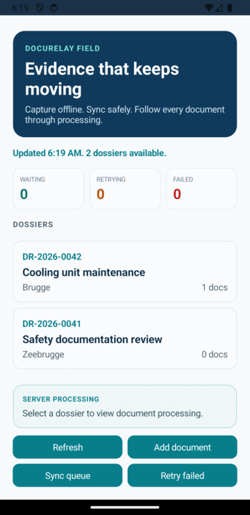
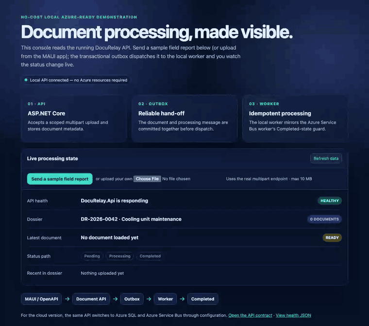
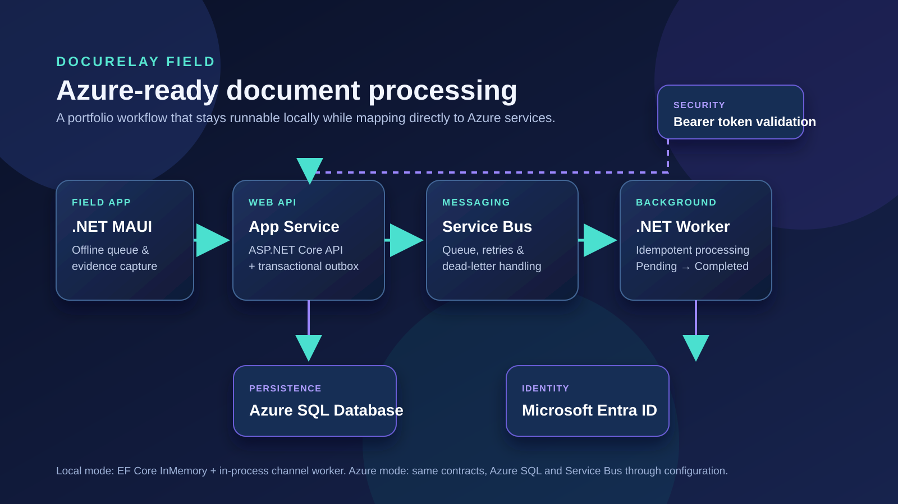

# DocuRelay Field

[](https://github.com/phlppgdfry/docurelay-field/actions/workflows/ci.yml)

> Offline-first field documentation for teams that cannot afford to lose evidence.

DocuRelay Field is a portfolio project demonstrating a realistic .NET MAUI workflow: a field worker opens a dossier, captures evidence, queues it while offline, and syncs it to an ASP.NET Core API when connectivity returns.


<table>
  <tr>
    <td width="34%" align="center"></td>
    <td width="66%" align="center"></td>
  </tr>
  <tr>
    <td align="center"><sub>The MAUI app on Android 14 (release APK built by CI)</sub></td>
    <td align="center"><sub>The API's live console at <code>/demo</code>: upload → outbox → worker → Completed</sub></td>
  </tr>
</table>

## Try it in one minute (no Azure, no phone)

```bash
dotnet run --project src/DocuRelay.Api --urls http://127.0.0.1:5086
# open http://127.0.0.1:5086/demo and press "Send a sample field report"
```

You watch the same path a field upload takes: the API stores the file and an outbox message in
one transaction, the dispatcher hands it to the worker, and the status goes
`Pending → Processing → Completed`. With Azure configuration the identical API uses Azure SQL,
Service Bus and Entra ID instead.

## Why this exists

This repository was built to demonstrate mobile engineering concerns that are easy to describe but harder to prove:

- REST API consumption with typed DTOs and `HttpClient`.
- A durable SQLite cache for dossiers and a persisted upload queue.
- Retryable document uploads that remain visible to the user when offline.
- Cross-platform .NET MAUI UI, testing, CI, and Android release packaging.

It is a standalone portfolio project. It has no relationship with an employer or customer.

## The workflow

```text
Field worker -> MAUI app -> local SQLite cache -> upload queue
                                 |                    |
                                 +-- offline ----------+
                                                      |
                                              connectivity restored
                                                      |
                                              ASP.NET Core API
```

1. Refresh dossiers from the API; the latest result is cached locally.
2. Add a document to a dossier. If the network is unavailable, the upload is queued.
3. Sync retries queued work in a controlled order and clearly reports failures.

## Tech stack

| Area | Choice |
| --- | --- |
| Mobile | .NET MAUI, MVVM, XAML, iOS and Android |
| Local persistence | SQLite via `sqlite-net-pcl` |
| Backend | ASP.NET Core Minimal API |
| Integration | REST, `HttpClient`, JSON, multipart upload |
| Quality | xUnit, GitHub Actions |
| Release | Android AAB artifact workflow, iOS release checklist |
| Cloud learning environment | Azure App Service, Azure SQL, Microsoft Entra ID, Service Bus, Container Apps and managed identities |

## Quick start

### API

```bash
dotnet run --project src/DocuRelay.Api
```

Without Azure configuration, the API starts with seeded dossiers in a temporary local database and exposes a health endpoint at `/health`. Set `ConnectionStrings:AzureSql` through user-secrets to use a real Azure SQL Database instead.

### Mobile app

```bash
dotnet workload restore
dotnet build src/DocuRelay.Mobile/DocuRelay.Mobile.csproj -f net10.0-android
```

Set `ApiOptions:BaseUrl` in `src/DocuRelay.Mobile/appsettings.json` to an API that is reachable from your device. An Android emulator typically needs `10.0.2.2` instead of `localhost`.

## Repository map

```text
src/
  DocuRelay.Api/        REST API with dossier and document endpoints
  DocuRelay.Contracts/  Shared API contracts
  DocuRelay.Mobile/     .NET MAUI client, cache and sync queue
tests/
  DocuRelay.Domain.Tests/  Fast, deterministic sync policy tests
docs/
  architecture.md       Design decisions and data flow
  offline-sync.md       Queue contract, retry semantics and failure handling
  release-checklist.md  Android and iOS release proof checklist
  azure-learning-guide.md  Azure architecture, identity setup and deployment proof
  local-demo.md         End-to-end local upload and processing walkthrough
  portfolio-walkthrough.md  Five-minute technical interview / demo script
```

## Evidence for a technical reviewer

- Start at [`SyncService`](src/DocuRelay.Mobile/Services/SyncService.cs) for the offline upload policy.
- Read [`SqliteOfflineStore`](src/DocuRelay.Mobile/Services/SqliteOfflineStore.cs) for durable local state.
- Inspect [`Program.cs`](src/DocuRelay.Api/Program.cs) for the runnable REST API.
- CI validates the API and unit tests; tag builds produce an Android package artifact. CI also runs weekly, so a newly published vulnerability in a (transitive) package fails the build within a week; Dependabot proposes the update.

## Verified Android runtime


The current release APK was built independently by GitHub Actions, installed on a Pixel 3a Android 14 emulator, and validated against the current local API. The selected dossier shows a real `README.md: Completed` result from the outbox and worker flow. See the [Completed-state screenshot](docs/assets/android-runtime-completed.png) and [compact GIF walkthrough](docs/assets/android-runtime-postfix-demo.gif). Full evidence and the historical capture are recorded in [`runtime-validation.md`](docs/runtime-validation.md).

## Roadmap

- [x] Dossier retrieval and local cache
- [x] Persisted upload queue and retry policy
- [x] API document endpoint and seeded data
- [x] Automated API and sync-policy tests
- [x] Android 14 emulator smoke test and runtime screenshot/demo
- [ ] Physical Android device smoke test
- [ ] iOS TestFlight internal build

## Azure portfolio extension

The API and a separate background worker are ready for an Azure implementation: uploads and their outgoing queue messages are committed together to Azure SQL, an outbox dispatcher publishes a versioned job on Azure Service Bus, and the worker updates the status once work completes. The Bicep environment uses managed identities rather than application secrets.



Read the [Azure learning guide](docs/azure-learning-guide.md) for the complete setup, Entra ID registration, Service Bus retry/dead-letter behaviour and GitHub OIDC deployment. Infrastructure is in [`infra/main.bicep`](infra/main.bicep).

## No-cost local demo

The same workflow runs fully locally: uploaded files are stored outside Git, an outbox dispatches messages to an in-process worker, and documents progress from `Pending` to `Completed`. Start the API, then open [`/demo`](http://127.0.0.1:5086/demo) for a visual live console where you can send a sample report or upload your own file, or follow [the local demo guide](docs/local-demo.md) for the full walkthrough and OpenAPI contract.

For a ready-made presentation flow, use the [portfolio walkthrough](docs/portfolio-walkthrough.md). It covers the mobile offline queue, retry handling, live worker processing, automated integration test and the Azure service mapping.

## License

MIT. See [LICENSE](LICENSE).
